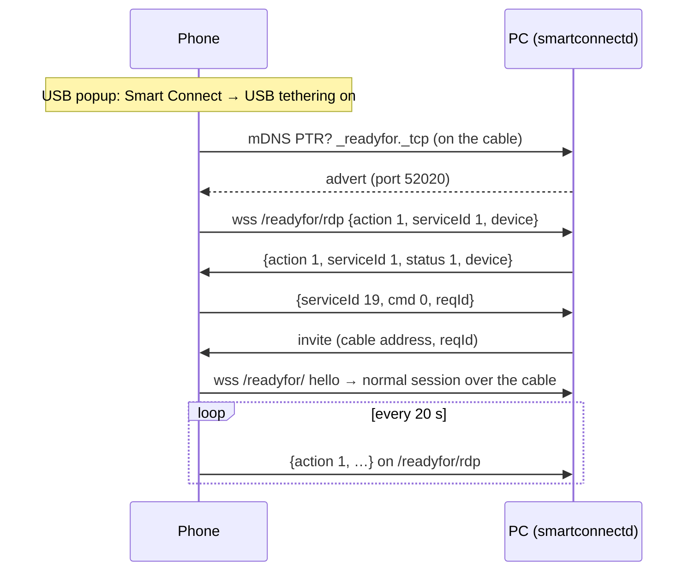

# Connection by USB cable

## What

The phone's own cable mode connects to the Linux PC:

- `discovery.rs`: `advertise_cable` publishes `_readyfor._tcp` (same TXT and port as
  `_readyformdns._tcp`); `main.rs` keeps it running next to the Wi-Fi advert.
- `server.rs`: `serve_cable` answers `/readyfor/rdp` (handshake echo, then the service 19 trigger
  with an invite whose only address is the socket's local one, i.e. the cable). Unknown first frames
  on the control path are now logged.
- `reconnect.rs`: `is_usb_tether` / `usb_tether_ips` / `is_on_usb_tether` recognise the PC end of a
  phone's USB tethering link by its kernel driver (`rndis_host`, `cdc_ncm`, `cdc_ether`, `cdc_eem`).
- `invite.rs`: `policies()` lists every address under `wifi` and cable addresses also under `usb`;
  used by the QR and by every invite (`discovery::invite_json`).
- `server.rs`: `remember_phone_ip` ignores a cable address, so the phone's `/readyfor/mdns`
  endpoint stays its Wi-Fi one.

## How it was found

On a motorola edge 70 max the cable connection never worked: the phone switched USB tethering on
and off every 30 to 45 s. A capture on the PC showed no TCP from the phone, only mDNS queries on the
cable for `_readyfor._tcp`. Advertising that service by hand made the phone dial `/readyfor/rdp`
with `{action: 1, serviceId: 1, …}`; echoing it got a service 19 `cmd 0` trigger; an invite with the
PC's Ethernet address got `cmd 2` `errorCode 65`; an invite with the cable address made the phone
dial `/readyfor/` over the cable. Protocol details: `docs/protocol/pairing-and-discovery.md#cable-mode-usb-tethering`.

## Why

- **Plain JSON on `/readyfor/rdp`, our own reply shapes.** No capture of a Windows PC in cable mode
  exists; these replies are the ones the phone accepts. The heartbeats are not answered and the
  session held for minutes.
- **Cable address in the rdp invite comes from the socket, not the LAN list.** The address watcher
  polls every 5 s and the phone asks within a second of a fresh link; an invite without the cable
  address fails with error 65 when phone Wi-Fi is off.
- **Cable addresses stay under `wifi` too.** Only then does the phone dial them from a QR; under
  `usb` alone pairing fails (the phone then labels the link Wi-Fi, a cosmetic issue).
- **Changing address per plug-in.** The phone randomises the RNDIS MAC, so DHCP gives a new IP each
  time. Cable mode copes (fresh invite every time); for QR/Connect a NetworkManager profile with a
  cloned MAC keeps it fixed. `src/cable_link.rs` does this: it polls `/sys/class/net` every 3 s for
  `rndis_host` links; for a new link that NetworkManager brought up under another profile it
  creates `smartconnect-phone-usb` if missing (`connection.permissions user:<me>`, so polkit's
  `settings.modify.own` suffices, no admin prompt) and runs `nmcli connection up ... ifname`. One try
  per interface name. Only `rndis_host` is matched: `cdc_ether`/`cdc_ncm` also drive docks and
  dongles, which must keep their MAC and default route. An existing profile of that name is never
  touched, so a hand-made one wins. `--no-cable-profile` opts out.

## Not verified

- Other phones and app versions; NCM instead of RNDIS tethering.
- What the genuine Windows PC sends on `/readyfor/rdp`.
